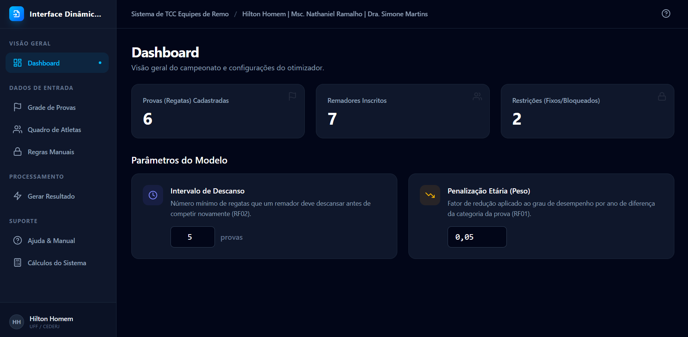
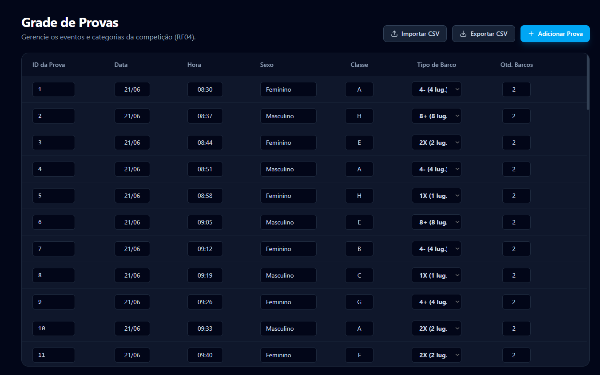
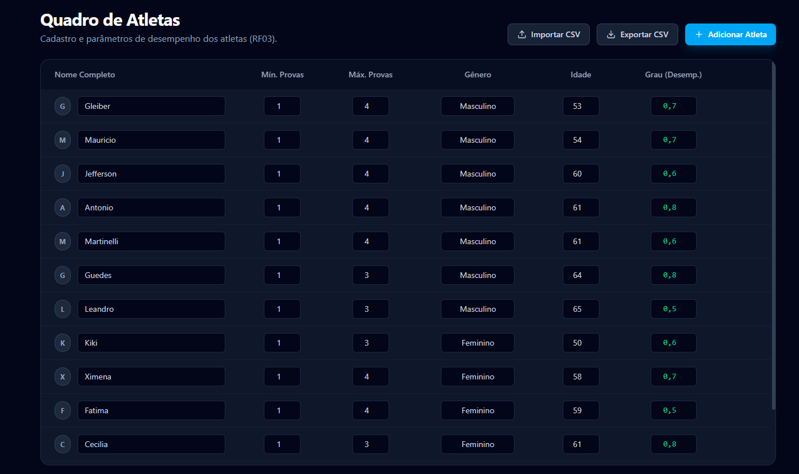
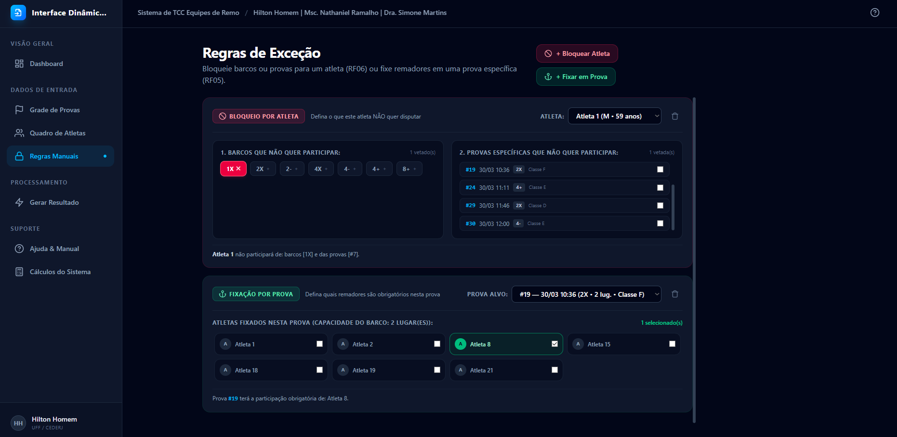
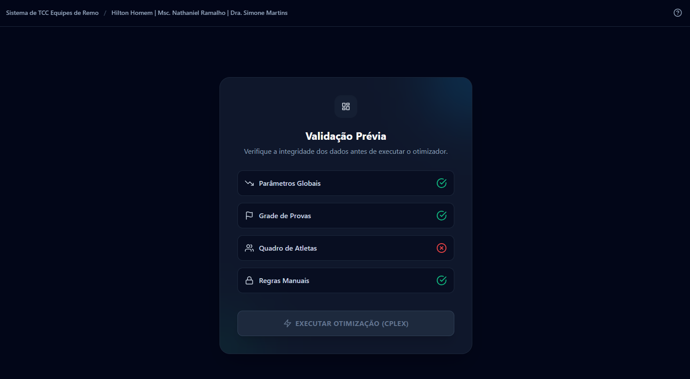

# 🚣‍♂️ Sistema Web de Alocação e Otimização para Remo Master

<div align="center">


**Plataforma Web interativa e responsiva para escalação ótima de remadores em regatas master, maximizando o desempenho das guarnições e atendendo a todas as restrições esportivas e fisiológicas.**

[Visão Geral](#-sobre-o-projeto) •
[Funcionalidades](#-funcionalidades-chave) •
[Modelo Matemático](#-fundamentação-matemática) •
[Templates CSV](#-estrutura-e-templates-dos-arquivos-csv) •
[Como Executar](#-como-executar-o-projeto) •
[Autoria](#-autoria-e-orientação)

---

</div>

## 📌 Sobre o Projeto

Este software é fruto do Trabalho de Conclusão de Curso (TCC) em Ciência da Computação pela **Universidade Federal Fluminense (UFF)**.

O objetivo do sistema é resolver o complexo problema de escalação de atletas de clubes de remo para regatas de categoria **Master** (World Rowing). O escalador precisa balancear múltiplos fatores: categorias de idade por prova (definidas pela média de idade do barco), cotas estritas de gênero, limites mínimo e máximo de participações de cada remador, janelas mínimas de descanso obrigatório entre provas e regras manuais de fixação ou bloqueio solicitadas pela comissão técnica.

A solução oferece uma interface moderna, dark mode com visual sofisticado, validação em 4 dimensões antes da execução e exportação de resultados em planilhas para a comissão técnica.

---

## 📸 Demonstração Visual

<div align="center">

| Visão Geral do Sistema | Grade de Provas |
|:---:|:---:|
|  |  |

| Quadro de Atletas | Fixar e Bloquear Atletas |
|:---:|:---:|
|  |  |

| Validação Prévia & Execução | Resumo de Participações & Solução |
|:---:|:---:|
|  |  |

</div>

---

## ✨ Funcionalidades Chave

- 📊 **Visão Geral Dinâmica (Dashboard):** Configuração em tempo real do *Intervalo de Descanso* ($\eta$) e do *Fator de Penalização Etária* ($\lambda$).
- 🚣 **Grade de Provas Flexível:** Cadastro e visualização de eventos com data, horário, gênero (Masculino, Feminino e Misto) e categorias de idade oficiais da FISA/World Rowing (A até M).
- 👥 **Quadro Completo de Remadores:** Gestão de atletas com idade, gênero, limites mínimo e máximo de provas ($min_i, max_i$) e índice técnico estimado ($pg_i$).
- 🔒 **Fixar / Bloquear Atletas:**
  - **Fixar em Prova (RF05):** Trava um ou mais atletas em determinada guarnição, preservando duplas e quartetos pré-definidos pelo treinador.
  - **Bloquear por Atleta (RF06):** Impede que remadores disputem tipos específicos de barco (ex: *1X Single Skiff*) ou regatas em horários conflitantes.
  - **Painel Inferior de Conferência:** Tabela consolidada com Prova, quantidade de barcos editável e remadores fixados em destaque.
- 🚦 **Validação Prévia em Quatro Dimensões:** Analisa a consistência dos parâmetros, integridade das provas, conformidade dos atletas e coerência das regras antes do processamento.
- ⚡ **Otimização e Alocação:** Execução rápida com apresentação dos barcos formados, médias de idade calculadas e pontuação da guarnição.
- 📈 **Resumo de Participações em Coluna Única:** Barras de progresso individuais por remador informando se o atleta atingiu o mínimo, atendeu ao limite ou ultrapassou o teto.
- 📑 **Importação e Exportação CSV:** Carga e descarga rápida de dados com compatibilidade para Excel e Google Planilhas.

---

## 📐 Fundamentação Matemática & Modelo de Referência

O núcleo de modelagem e resolução é baseado na formulação matemática desenvolvida na dissertação de mestrado de **Nataniel Ramalho (2024)**, sob orientação da Profª. Dra. Simone Martins, que modela o problema de escalação ótima de remadores em regatas master através de Programação Linear Inteira Mista (PLIM):

$$\max \sum_{j \in J} \sum_{k \in K_j} b_{jk}$$

### Sujeito a:
1. **Atendimento de Gênero:** Barcos masculinos contêm apenas remadores masculinos, femininos apenas femininas, e provas mistas respeitam a divisão 50/50.
2. **Limite de Barco por Prova:** Um atleta não pode remar mais de uma vez na mesma regata:
   $$\sum_{k \in K_j} x_{ijk} \le 1, \quad \forall i \in I, \forall j \in J$$
3. **Limites de Participação Individual:**
   $$min_i \le \sum_{j \in J} \sum_{k \in K_j} x_{ijk} \le max_i, \quad \forall i \in I$$
4. **Média Etária da Guarnição:** A média de idade dos remadores deve ser maior ou igual à idade mínima da categoria da regata:
   $$\frac{\sum_{i \in I} a_i \cdot x_{ijk}}{L_j} \ge \text{IdadeMin}_j$$
5. **Intervalo de Descanso entre Provas:** Se um atleta competir na prova $j$, fica impedido de remar em regatas no intervalo de descanso fisiológico $[j - \eta, j + \eta]$.
6. **Penalização por Envelhecimento:**
   $$g_{ij} = pg_i - (a_i - \text{IdadeMin}_j) \times \lambda$$
   onde $b_{jk} = \frac{1}{L_j} \sum_{i \in I} g_{ij} \cdot x_{ijk}$.

---

## 📁 Estrutura e Templates dos Arquivos CSV

O sistema permite a ingestão automática por meio de arquivos `.csv` (codificados em UTF-8 com delimitador `;` ou `,`):

### 1. Grade de Provas (`arqbasedia1.csv` / `exemplo_provas.csv`)
> **Padrão:** O número de barcos por padrão é **2**, e as restrições manuais são fornecidas na interface web.

```csv
Id;Data;Hora;Sexo;Classe;Tipo
1;21/06;08:30;W;A;4-
2;21/06;08:37;M;H;8+
3;21/06;08:44;W;E;2x
4;21/06;08:51;M;A;4-
5;21/06;08:58;W;H;1x
```

### 2. Quadro de Atletas (`atletasdia1.csv` / `exemplo_atletas.csv`)

```csv
Nome;Minimo;Maximo;Sexo;Idade;Grau
Atleta 1;1;3;M;59;0.2
Atleta 2;1;3;M;59;0.8
Atleta 18;1;3;W;44;0.7
Atleta 19;1;3;W;57;0.9
```

---

## 🛠️ Tecnologias Utilizadas

- **Frontend:** [React 19](https://react.dev/) + [Vite](https://vitejs.dev/)
- **Estilização:** [Tailwind CSS v4](https://tailwindcss.com/)
- **Ícones:** Lucide React / SVGs Inline Otimizados
- **Formato de Dados:** CSV RFC-4180
- **Versionamento & Deploy:** Git, GitHub & GitHub Pages / Hostinger

---

## 🚀 Como Executar o Projeto

### Pré-requisitos
- [Node.js](https://nodejs.org/) versão 18 ou superior instalado
- Gerenciador de pacotes `npm` ou `yarn`

### Passo a Passo

1. **Clone o repositório:**
   ```bash
   git clone https://github.com/HiltonHomem/Sistema-Web-Remo.git
   cd Sistema-Web-Remo/frontend
   ```

2. **Instale as dependências:**
   ```bash
   npm install
   ```

3. **Inicie o servidor de desenvolvimento:**
   ```bash
   npm run dev
   ```

4. **Acesse no navegador:**
   Abra `http://localhost:5173` para interagir com a aplicação.

5. **Gere a build de produção:**
   ```bash
   npm run build
   ```

---

## 📂 Arquitetura do Repositório

```text
Sistema-Web-Remo/
├── arqbasedia1.csv          # Base oficial de provas para testes
├── atletasdia1.csv          # Base oficial de atletas para testes
├── exemplo_provas.csv       # Template simplificado de provas
├── exemplo_atletas.csv      # Template simplificado de atletas
├── fotos/                   # Capturas de tela e diagramas da aplicação
└── frontend/                # Aplicação Web (React + Vite)
    ├── public/              # Favicon e ícones estáticos
    ├── src/
    │   ├── App.jsx          # Interface, estados, validação e motor do sistema
    │   ├── main.jsx         # Ponto de entrada React
    │   └── index.css        # Folha de estilos e Tailwind CSS
    ├── index.html           # Documento HTML principal
    ├── package.json         # Dependências e scripts npm
    └── vite.config.js       # Configuração do Vite
```

---

## 👨‍💻 Autoria, Orientação & Referências
 
- **Desenvolvimento da Aplicação & TCC:** [Hilton dos Santos Homem](https://github.com/HiltonHomem)
- **Orientadora:** Profª. Dra. Simone Martins
- **Base Teórica e Formulação Matemática:** Dissertação de Mestrado de **Nataniel Ramalho** (*"Otimização da Alocação de Remadores em Regatas Master"*, UFF, 2024), cujo modelo matemático serviu de fundação conceitual para o desenvolvimento desta plataforma web.
- **Instituição:** Universidade Federal Fluminense (UFF) — Instituto de Computação
- **Área:** Pesquisa Operacional, Algoritmos de Otimização e Engenharia de Software
 
---
 
<div align="center">
Desenvolvido com dedicação para a comunidade de Remo Master do Brasil 🇧🇷
</div>
